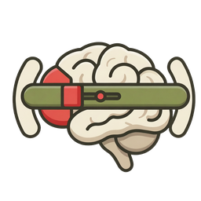
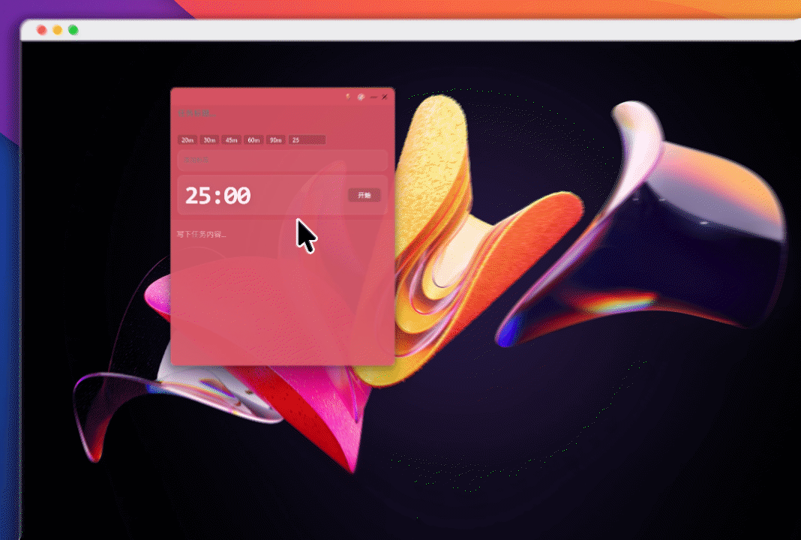
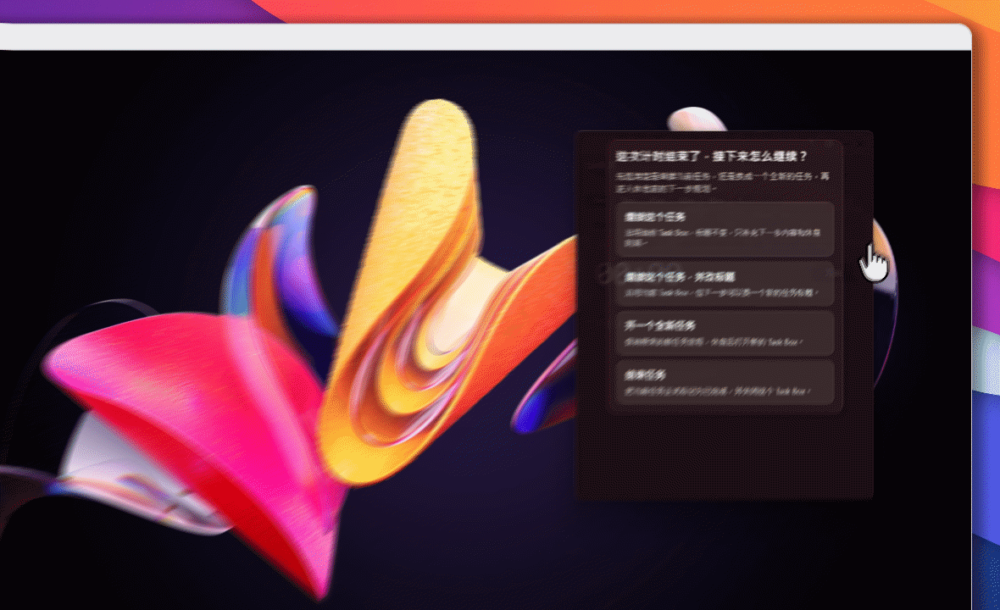
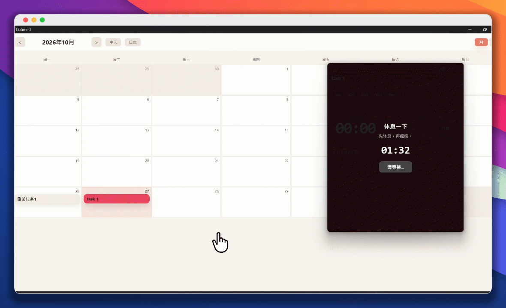

  

<h1 align="center">脑闸 · Cutmind</h1>

<strong>简体中文</strong> · <a href="README.en.md">English</a>

<strong>桌面任务便笺与专注计时，休息前写好下一步。</strong>

  <a href="#features">功能与演示</a> ·
  <a href="#start">下载与使用</a> ·
  <a href="#why">为什么做、相关研究</a> ·
  <a href="#credits">致谢、License</a>

  
  
  

---

我经常在电脑前一坐就是几个小时。明明已经到了该休息的时候，却总想着再改一点、再查一份资料，结果一不留神又过去了半个小时。有时候好不容易离开电脑，脑子里还在惦记刚才没做完的事。等休息回来，又得花时间想起自己原本准备做什么。

于是我做了「脑闸」，想给工作和休息之间加一道小小的闸门。

每轮工作计时结束后，如果还想继续，脑闸会让我先写下回来要做的下一件事，比如“把第二篇资料里的例子补到开头”，然后去休息。任务和笔记会留在桌面的浮窗里，临时冒出来的其他想法也可以随手记到便笺中。

我希望自己能够安心离开电脑，休息的时候少惦记一些，回来时也能直接接着做。

## ✨ 功能与演示

### 想法盒子

想到一个点子时，先写进想法盒子，不必立刻安排时间。它是独立的桌面便笺，可以调整颜色和位置，暂时隐藏后内容仍然保留。

### 转换成任务

准备处理其中一件事时，在便笺里选中对应的文字，右键打开菜单，点击“选中文字 → 创建任务”。这段文字会成为任务标题，并打开独立的任务窗口；原来的便笺仍然保留，可以继续补充其他想法。

### 桌面任务与计时

把“写方案”改成这次能做的一件事，例如“列出三个要回答的问题”，选好时长，点击“开始”。标题、笔记和倒计时放在同一个独立浮窗里，可以置顶，也能随时暂停。工作做到哪里，直接记在这张任务便笺上。

### 强制休息

计时归零，事情未必做完。你可以继续原任务、改标题继续、另开一个任务，或明确结束这件事。准备继续或换任务时，需要写下下一步内容，并确认休息时长。

休息结束后，点击“继续当前任务”，刚写的内容会追加到笔记末尾，并开始新一轮计时；只有选择“结束任务”，才会把任务标为完成。休息期间，继续按钮不可用：专注不足 20 分钟时至少休息 1 分钟，20 分钟起至少 5 分钟，50 分钟起至少 10 分钟。

### 日历复盘

一天结束后，在月历里找到当天的任务，点开查看笔记和每段专注记录，回顾自己做了什么、停在了哪里。切换到周视图，可以按时间查看任务安排。需要接着处理时，也能在详情里编辑内容，或重新打开任务浮窗。

需要把记录带到自己的笔记工具中，可以导出 Markdown、JSON 或 JSONL；设置每日日志目录后，任务变化会自动同步到按日保存的 Markdown 文件。任务、想法和设置保存在本机。

## 🚀 下载与使用

适用于 **Windows x64**，版本 **1.1.0**。

1. **安装并打开。** 下载 [Cutmind_1.1.0_x64-setup.exe](https://github.com/Lucian-D-W/Cutmind/releases/download/v1.1.0/Cutmind_1.1.0_x64-setup.exe)，运行安装程序，然后从开始菜单打开 Cutmind（脑闸）。日常使用无需安装 Node.js、Rust 或其他开发工具。
2. **先记录想法。** 按默认快捷键 `Ctrl+Shift+I` 打开想法盒子，写下想到的事情。
3. **把想法转换成任务。** 选中准备处理的文字，右键选择“选中文字 → 创建任务”，打开对应的任务窗口。
4. **开始一轮工作。** 在桌面任务窗口补充本轮准备做的具体内容，选择时长并点击“开始”。
5. **计时结束后休息。** 还要继续，就先写下一步、确认休息时间；等休息结束，点击继续按钮再开始工作。事情做完了则选择“结束任务”。
6. **在日历中复盘。** 按 `Ctrl+Alt+C` 打开日历，回看任务笔记与专注记录。提醒、外观、快捷键和日志目录可以从托盘的“首选项”调整。

开发者的环境、构建命令与数据目录说明见[开发与维护说明](docs/guides/DEVELOPMENT.md)。

## 💡 为什么做、相关研究

我在设计脑闸时，主要考虑了两个问题：为什么明明停下了工作，脑子却还在想着它？又怎样才能在离开之前，把回来要做的事交代清楚？

下面三篇研究给了我一些启发。

**参考文献**

**1. Why is it so hard to do my work? The challenge of attention residue when switching between work tasks**\
Sophie Leroy，2009，*Organizational Behavior and Human Decision Processes*，109(2)，168–181。[期刊摘要](https://www.sciencedirect.com/science/article/pii/S0749597809000399)。

这篇研究讨论了“注意力残留”（Attention Residue）：人从一件工作切换到另一件工作时，注意力可能还停留在前一件未完成的事情上，影响接下来任务的表现。

这让我想到，休息时仍然惦记工作的情况，也可能与这种注意力难以切换的现象有关。

**2. Tasks Interrupted: How Anticipating Time Pressure on Resumption of an Interrupted Task Causes Attention Residue and Low Performance on Interrupting Tasks and How a “Ready-to-Resume” Plan Mitigates the Effects**\
Sophie Leroy、Theresa M. Glomb，2018，*Organization Science*，29(3)，380–397。[期刊摘要](https://doi.org/10.1287/orsc.2017.1184) · [大学研究介绍](https://www.washington.edu/news/2018/01/16/task-interrupted-a-plan-for-returning-helps-you-move-on/)。

研究发现，当人担心被打断后没有足够时间继续原来的工作时，注意力更容易停留在未完成的任务上。而在切换之前，花一点时间想清楚回来后怎样继续，可以减轻这种影响。

这启发了脑闸的一个核心功能：**离开电脑前，先给回来后的自己留一句具体的交代。**

**3. Implementation intentions and effective goal pursuit**\
Peter M. Gollwitzer、Veronika Brandstätter，1997，*Journal of Personality and Social Psychology*，73(1)，186–199。[论文原文](https://sparq.stanford.edu/sites/g/files/sbiybj19021/files/media/file/gollwitzer_brandstatter_1997_-_implementation_intentions_effective_goal_pursuit.pdf)。

这篇研究探讨了“执行意图”（Implementation Intentions），也就是提前想好在什么情况下采取什么行动。例如，单纯决定“今天要继续写报告”，与提前确定“休息回来后，先补充报告第二部分的例子”，是两种不同的计划方式。研究发现，后一种具体的情境与行动安排有助于目标的执行。

它让我更加重视脑闸中那句简短的下一步计划：写下一个明确的动作，比只留下“继续工作”更容易让自己重新开始。

**设计参考与应用**

这三篇研究让我开始认真考虑工作结束时的那几分钟。

所以，我给脑闸设计了一条规则：一轮工作结束后，如果还要继续，就先写下下一步，再进入休息。休息结束后，桌面上仍然保留着那句话，方便直接接上之前的工作。

我还给连续工作设置了休息间隔，不让自己刚结束一轮就马上开始下一轮。这是我根据自己的使用习惯做出的设计选择。

我希望脑闸能帮我做到两件很普通的事：该休息的时候真的休息，回来工作的时候知道从哪里开始。

## 🙏 致谢、License

感谢 [Tauri](https://tauri.app/)、[React](https://react.dev/)、[Zustand](https://github.com/pmndrs/zustand)、[Floating UI](https://floating-ui.com/)、[date-fns](https://date-fns.org/) 与 [DOMPurify](https://github.com/cure53/DOMPurify) 等项目，为桌面窗口、界面、状态管理和内容处理提供基础。第三方许可与署名见[第三方说明](THIRD_PARTY_NOTICES.md)。

Copyright (C) 2026 **Lucian W. (lucian-d-w)**。项目原创代码、文档及大脑与闸杆图标采用 **[GPL-3.0-only](LICENSE)**，适用范围见 [NOTICE](NOTICE)。第三方组件保留各自许可。
